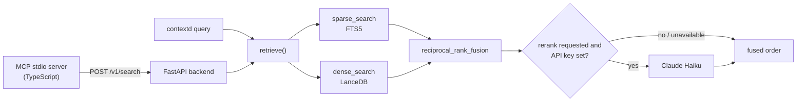

# contextd

A local retrieval server that indexes your PDFs, Claude conversation exports and git repos, and lets any MCP client (Claude Code, Codex CLI, Cursor, Continue) query them.


*Architecture plate drawn from the module and table names in `contextd/` and `mcp-server/src/`. It is a diagram, not a measurement.*

## What it does

- Ingests PDFs, Claude conversation exports (JSON) and git repositories (HEAD tree only) into named corpora. Re-running an ingest on unchanged content skips it; `--force` re-ingests.
- Keeps each corpus in its own SQLite database (`chunks.db`, with an FTS5 index) and its own LanceDB database (`vectors.lance`, holding one table named `embedding`). A query names one corpus and reads only that one.
- Retrieves with BM25 and BGE-M3 dense search, fused by reciprocal rank fusion. Reranking with Claude Haiku is on by default and takes effect only when `ANTHROPIC_API_KEY` is set.
- Serves the same index through a CLI (`ingest`, `query`, `list`, `forget`, `status`, `serve`, `config`, `version`, `eval`), a local FastAPI backend (`/v1/*`) and a TypeScript MCP stdio server with 7 tools.
- Reads sources without modifying them: output goes to the contextd data home (`~/.contextd/`, override with `CONTEXTD_HOME`), and a CI test hashes the source tree before and after ingest for the PDF and Claude export adapters.

## Quickstart

Prerequisites: macOS or Linux, [uv](https://docs.astral.sh/uv/), Python 3.12 (pinned in `.python-version`; `pyproject.toml` allows 3.11 to 3.13), and Node 22 or newer with pnpm for the MCP server. The first ingest or query downloads the BGE-M3 model from `huggingface.co`; see [When data leaves your machine](#when-data-leaves-your-machine).

`contextd` is not published to PyPI. The `contextd` package there is a different project, so install from source:

```bash
git clone https://github.com/shifosss/personal-RAG-for-everything.git contextd
cd contextd
uv sync --dev
uv run contextd --help
```

Ingest and query a corpus. Re-running the same ingest reports the sources as skipped:

```bash
uv run contextd ingest tests/fixtures/pdfs --corpus demo
uv run contextd query "lorem ipsum" --corpus demo --limit 3 --no-rerank
```

`ingest` also takes a Claude export JSON file or a local git clone, for example `uv run contextd ingest ~/code/my-project --corpus research`. `query` takes `--rerank/--no-rerank` (default on), `--rewrite/--no-rewrite` (default off) and `--json`.

To use the corpora from an MCP client, build the TypeScript server once, then start `contextd serve`, which runs the HTTP backend and the stdio MCP server together:

```bash
cd mcp-server
pnpm install --frozen-lockfile
pnpm run build
cd ..
uv run contextd serve
```

`contextd serve` needs `mcp-server/dist/index.js` and stops with a build instruction if it is missing. Point the client at the clone. The Claude Code and Codex snippets below are untested. Claude Code (`.mcp.json` or `~/.claude.json`):

```json
{
  "mcpServers": {
    "contextd": {
      "command": "uv",
      "args": ["--directory", "/path/to/contextd", "run", "contextd", "serve"]
    }
  }
}
```

Codex CLI (`~/.codex/config.toml`):

```toml
[mcp_servers.contextd]
command = "uv"
args = ["--directory", "/path/to/contextd", "run", "contextd", "serve"]
```

The server is multi-corpus. Every tool except `list_corpora` takes `corpus` as a parameter, and `list_corpora` shows what exists. The 7 tools are `search_corpus`, `fetch_chunk`, `expand_context`, `get_edges`, `list_sources`, `get_source` and `list_corpora`. The full walkthrough is in the [User Guide](./docs/USER_GUIDE.md).

## How it works

Ingest runs a per-type adapter, chunks the text, hashes each source, and writes chunks, edges and embeddings into the corpus stores. A query runs the BM25 lane and the dense lane in parallel, fuses their rankings, optionally reranks the top 50, and hydrates the chunks. If one lane fails or the reranker is unavailable, the query logs a warning and returns what it has.



The MCP server holds no index. It forwards every tool call to the HTTP backend on `127.0.0.1:8787`, and the backend calls the same `retrieve()` as the CLI.

## When data leaves your machine

Two things connect to the network by default.

- **Model download.** The first ingest or query downloads the BGE-M3 model and tokenizer from `huggingface.co`. After the cache is warm, this does not repeat.
- **Reranking.** `query` and the MCP `search_corpus` tool rerank by default. If `ANTHROPIC_API_KEY` is set in the environment or in a `.env` file, up to 50 candidate chunks (each cut to 3,200 characters, about 800 tokens) are sent to the Anthropic API along with the query text. With no key the call is skipped and the query still succeeds.

To turn reranking off, pass `--no-rerank` on the CLI, or `rerank: false` in the `search_corpus` call. `--rewrite` is off by default; when enabled it sends the query text to Anthropic. `contextd eval` also reranks by default, so it sends chunk text to Anthropic unless you pass `--no-rerank`, and it calls Anthropic for its judge unless you pass `--no-judge`.

The code contains no telemetry, analytics or crash-reporting client. With no key set and a warm model cache, a CLI query opened no outbound connection in a probe run with the embedder and tokenizer stubbed.

## Status and limits

Last checked on 2026-11-06 at commit `cf615dc`.

- **Not run end to end on the real model.** The BGE-M3 download stalled on the large files in that check, so ingest and query were run with the embedder and tokenizer stubbed (real CLI, SQLite, FTS5, LanceDB and RRF; meaningless dense vectors). No retrieval-quality numbers exist for this build.
- **Not run:** `contextd serve` against a live port, any MCP tool call, and the Claude export and git ingests. The FastAPI app is covered by in-process tests (`tests/integration/mcp/test_api.py`, passing), and the built MCP server answers `tools/list` with the 7 tools above.
- **Tests need `huggingface.co`.** Three adapters load the BGE-M3 tokenizer from the Hub. Offline (`HF_HUB_OFFLINE=1 uv run pytest`) 117 pass and 11 fail on that download; online without a reachable Hub the run hangs. `uv run pytest -m privacy` passes (4 tests), but it runs with `--no-rerank` and a stubbed embedder, so it does not cover the default rerank path or the model download. `tests/integration/mcp/test_stdio_subprocess.py` needs `pnpm run build` first.
- **Retrieval gate is informational.** `contextd eval` runs the 30-query seed set against a Recall@5, Recall@10, MRR and judge-score gate, but the CI `eval` job is `continue-on-error`. The gate has not been measured on the real model.
- **Misleading output.** `contextd status` prints `network_default: offline` as a fixed string, even when a key is set. The `retrieval_rerank_enabled` and `retrieval_rewrite_enabled` settings are defined but not read.
- **Not built:** web UI, auto-sync connectors (Notion, Gmail, web), cross-corpus search, team sharing.
- **Not packaged.** The wheel contains `contextd/` only, so the TypeScript server needs a source checkout.

Further reading: [`docs/PRDs/`](./docs/PRDs/) (v0.1 product spec), [`docs/plans/`](./docs/plans/) (per-phase plans), [`CLAUDE.md`](./CLAUDE.md) (project instructions for Claude Code).

## License

MIT. See [LICENSE](./LICENSE).
